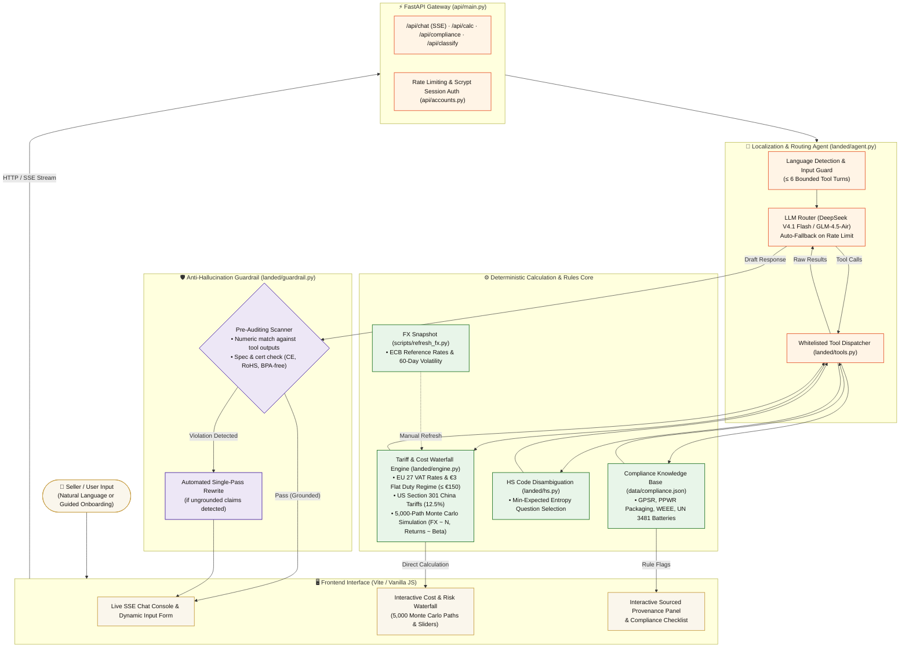

# 到岸 Landed — The Landed Price, Sourced.

> **Cross-Border Landed-Cost & Localization Agent**  
> **赛道分类 / Competition Track:** 第二届全国人工智能应用创新大赛 · 出海赛道 (The 2nd National AI Application Innovation Competition — Global Expansion Track)  
> **Core Value Proposition:** Sourced landed-cost calculation, risk-buffered pricing, compliance pre-checks, and localized listing drafts for cross-border e-commerce sellers shipping from China to the EU (and, indicatively, the US).
>
> **Scope today:** EU prices for parcels below €150 in all 27 member states. US prices are an indicative lower bound only. Orders above €150 and markets outside the EU and US get an explanation, not a price. See [Coverage & Scope](#-coverage--scope).

[](https://fastapi.tiangolo.com/)
[](https://vitejs.dev/)
[](https://www.python.org/)
[](LICENSE)
[](#-test-and-evaluate)

---

## 💡 The Thesis: Rule Zero

> **"Numbers never come from the language model."**

Language models are good at understanding a seller's description and writing in many languages. They are unreliable at customs arithmetic and at knowing current rules: in our eval, the same model without tools mentioned the EU's July 2026 €3 flat duty in 0 of 26 answers (see [`eval/RESULTS.md`](eval/RESULTS.md)).

**Landed splits the responsibility:**
1. **The LLM** handles conversational intent, parses unstructured product descriptions, selects tools, and writes localized listing copy in the destination language.
2. **Deterministic Python code** computes every rate, fee, VAT, currency conversion, duty waterfall, and Monte Carlo risk distribution from sourced tables.
3. Every number displayed carries a **snapshot date** and an explicit audit status (`verified`, `secondary`, or `assumption`); verified and secondary figures also carry a **source URL**.

---

## 🏛 Architecture & Data Flow

User requests flow from the frontend, through the FastAPI gateway and agent loop, into the deterministic calculation engine. Every answer is checked against tool output before it reaches the seller.

### Architecture Workflow Diagram



### High-Level ASCII Workflow

```text
+-----------------------------------------------------------------------------------------+
|                                1. SELLER INPUT                                          |
|  "500ml portable blender with battery, ¥38 cost, 0.6kg, shipping to Germany (25% margin)"|
+-----------------------------------------------------------------------------------------+
                                             |
                                             v
+-----------------------------------------------------------------------------------------+
|                         2. AGENT LOOP & ROUTING (FastAPI + LLM)                         |
|  - Language Detection (Chinese/English) & Input Guard (check for cost, weight, market)   |
|  - "Ask only what changes the money": Below €150 EU duty is flat €3/category            |
|    -> Skips irrelevant questions (no need to ask about motor specs before pricing)      |
+-----------------------------------------------------------------------------------------+
                                             |
                                             v
+-----------------------------------------------------------------------------------------+
|                     3. DETERMINISTIC ENGINE & PROVENANCE TABLES                         |
|  - Landed Cost Waterfall: COGS + Sourced Freight + Flat EU Duty (€3) + VAT (19% DE)     |
|  - Risk Engine: 5,000 NumPy Monte Carlo paths (ECB FX volatility + Beta returns)        |
|  - Compliance Pre-Audit: UN 3481 Li-ion packing (PI 967), Food contact, PPWR register   |
+-----------------------------------------------------------------------------------------+
                                             |
                                             v
+-----------------------------------------------------------------------------------------+
|                  4. POST-GENERATION GUARDRAIL (Anti-Hallucination)                      |
|  - Scans draft answer across 9 languages for unverified numbers or fake specs           |
|  - Rejects unverified claims (e.g. "CE-certified", "BPA-free") -> 1-pass auto rewrite   |
+-----------------------------------------------------------------------------------------+
                                             |
                                             v
+-----------------------------------------------------------------------------------------+
|                           5. REACTIVE FRONTEND DELIVERY                                 |
|  - Real-time SSE streaming answer with recommended price & risk-buffered floor price    |
|  - Interactive live SVG waterfall, Monte Carlo margin histogram, and provenance audit   |
+-----------------------------------------------------------------------------------------+
```

---

## ⚡ Quick Start Guide (Under 2 Minutes)

Get the full application running locally with copy-pasteable terminal commands.

### Prerequisites
- **Python 3.11+** installed
- **Node.js 18+** & `npm` installed
- An API key from any OpenAI-compatible provider (e.g., [Zhipu GLM](https://open.bigmodel.cn/) or [OpenRouter](https://openrouter.ai/))

---

### Step-by-Step Setup

#### 1. Clone the repository
```bash
git clone https://github.com/davensutejo/Landed.git
cd Landed
```

#### 2. Configure Python environment & install dependencies
```bash
# Create virtual environment
python -m venv .venv

# Activate virtual environment:
# On Windows:
.venv\Scripts\activate
# On Linux / macOS:
# source .venv/bin/activate

# Install Python requirements
pip install -r requirements.txt
```

#### 3. Set up environment variables
```bash
# Copy template configuration
cp .env.example .env
```
Open `.env` in your editor and insert your LLM API key. Recommended options:
- **Option A (China Direct - Zhipu GLM):**
  ```env
  LLM_API_KEY=your_glm_api_key_here
  LLM_BASE_URL=https://open.bigmodel.cn/api/paas/v4/
  LLM_MODEL=glm-4.5-air
  LLM_THINKING=disabled
  ```
- **Option B (Global - OpenRouter with DeepSeek & Auto-Fallback):**
  ```env
  LLM_API_KEY=your_openrouter_key_here
  LLM_BASE_URL=https://openrouter.ai/api/v1
  LLM_MODEL=deepseek/deepseek-v4.1-flash
  LLM_FALLBACK_MODEL=nvidia/nemotron-3.5-super-vl:free
  LLM_THINKING=disabled
  ```

#### 4. Install frontend packages & build assets
```bash
npm install
npm run build
```

#### 5. Launch the application
```bash
python -m uvicorn api.main:app --host 0.0.0.0 --port 8000
```
Open **[http://localhost:8000](http://localhost:8000)** in your browser!

> 💡 **For Frontend Development with Hot Reload:** Run `npm run dev` in a separate terminal. Vite will serve on `http://localhost:5173` and automatically proxy backend API requests to port `8000`.

---

### Alternative: Run with Docker in 30 Seconds

If you have Docker installed, launch the entire application with persistent volume storage in a single command:

```bash
# Build and run container
docker compose up -d --build

# View logs
docker compose logs -f
```
Open **[http://localhost:8000](http://localhost:8000)**.

---

## 🏰 What Makes It Different

Landed is built as an auditable pricing and compliance copilot: the model talks, the code computes, and every figure can be traced to a source.

### 1. Compliance Pre-Checks & Anti-Hallucination Guardrail
- **Compliance checks:** evaluates product attributes against destination rules:
  - **EU GPSR & PPWR:** flags the PPWR packaging producer registration (an EU regulation, applied from 12 Aug 2026, but registration is per country, with an authorised representative in each) (`secondary` source).
  - **Batteries:** flags IATA Packing Instruction 967 / UN 3481 for equipment containing lithium-ion cells.
  - **Food contact & WEEE:** a food-contact declaration for kitchenware, and WEEE producer registration (in each destination country) for any electrical product.
- **Guardrail (`landed/guardrail.py`):**
  - Checks generated listings and explanations in **9 EU listing languages** plus Chinese.
  - Flags money figures and percentages (symbol before or after, e.g. `€26.37` or `26,37 €`), product specs (W, mAh, ml) and certification or property claims (`CE`, `RoHS`, `BPA-free`, `TÜV`…) that appear in neither tool output nor the seller's messages.
  - On a hit, the agent gets one rewrite pass. Anything still unverified after that is shown to the seller as a warning.
  - It is a pattern-based check, so it reduces invented claims but cannot catch every paraphrase.

### 2. Sourced FX & Empirical Volatility
- **ECB reference rates (`scripts/refresh_fx.py`):** a script you run to pull the official EUR/CNY and USD/CNY (cross) rates from the European Central Bank. The repository ships a dated snapshot, and refreshing is a manual step.
- **Empirical volatility:** standard deviation of 42-trading-day (≈60 calendar days) log changes in EUR/CNY over two years of ECB history.
- **Monte Carlo:** a seeded 5,000-path simulation (NumPy + SciPy) with Gaussian FX and Beta-distributed returns gives a **95% margin-at-risk floor price**. It is a simulated estimate under those assumptions, not a guarantee.

### 3. Latency & Fallbacks
- **Latency:** about 2–8 s per turn on `glm-4.5-air` with thinking disabled. On OpenRouter, eval cases averaged about 9 s (DeepSeek V4.1 Flash) and 12 s (Nemotron). The arithmetic itself is negligible next to the model call.
- **Fallback model:** if the main model is rate-limited (429), out of credit (402), times out, or returns a 5xx error, `landed/agent.py` retries on `LLM_FALLBACK_MODEL`.
- **Calculator without chat:** if no model is reachable, the deterministic calculator keeps working, and the chat says so plainly.

### 4. "Ask Only What Changes the Money"
- Under the EU's 1 Jul 2026 customs reform, parcels below €150 pay a **flat €3 duty per kind of item**, whatever the HS code, so the code does not change an EU price below €150.
  - Landed asks only for the four inputs that do change it (cost, weight, market, margin) and then prices.
  - Where the code does change duty (US, or orders above €150), `landed/hs.py` picks the single next question that most reduces uncertainty over the candidate codes.
  - **Bundles (WCO GRI 3(b)):** shows when declaring components as one retail set would cut the number of €3 categories.

---

## 📂 Repository Layout

| Directory / File | Description |
|---|---|
| `data/rates.csv` | Sourced rates (duty, VAT, FX, platform fees), each with `source_url`, `snapshot_date`, and status (`verified`, `secondary`, `assumption`). |
| `data/hs_tree.json` | HS classification taxonomy, chapter notes, and discriminating attribute tree. |
| `data/compliance.json` | Multi-jurisdiction compliance flags (GPSR, PPWR, UN 3481, food contact, WEEE, etc.). |
| `data/platforms.json` | Sourced referral commissions for major marketplaces across the EU and US. |
| `landed/engine.py` | Core cost waterfall, 5,000-path Monte Carlo risk simulation, stress tests, and bundle logic. |
| `landed/agent.py` | Bounded agent loop (≤ 6 tool rounds), SSE streaming event generator, and system prompt. |
| `landed/guardrail.py` | Post-generation audit engine verifying numbers, specifications, and certification claims. |
| `landed/hs.py` | Entropy-minimizing HS code classifier and disambiguation dialogue engine. |
| `landed/tools.py` | Strict whitelisted tool definitions and dispatcher for LLM execution. |
| `api/main.py` | FastAPI application serving streaming endpoints (`/api/chat`, `/api/calc`, `/api/compliance`) and static UI. |
| `api/accounts.py` | Persistent session management, SQLite storage, scrypt password hashing, and user profile sync. |
| `src/` | Interactive landing page, cost waterfall visualizer, and onboarding flow (Vite + GSAP). |
| `src/lib/engine.js` | Zero-dependency JavaScript port of the engine's price, Monte Carlo and stress logic, with the same refusals (EUR 150 ceiling, unreachable margin). The landing page runs it on the Germany demo product. |
| `scripts/refresh_fx.py` | Manual refresh of the ECB reference rates and historical volatility in `data/rates.csv` and the `src/` copies. |
| `tests/` | Unit and integration tests covering the engine, agent loop, guardrails, accounts, and compliance logic. |
| `eval/` | Eval harness comparing Landed with the same model without tools (36 headline cases, plus wider and realistic-seller suites). |

---

## 🧪 Test and Evaluate

Run the test suite and evaluation benchmarks:

```bash
# Unit & integration tests
pytest -q tests

# Run offline price formula closed-form backtest (all 27 EU nations)
pytest tests/test_backtest.py tests/test_api_backtest.py

# Run real-world seller evaluation benchmark (calls configured LLM)
python -m eval.run_eval
```

### Eval Highlights ([`eval/RESULTS.md`](eval/RESULTS.md))
Landed vs. the same model (`glm-4.5-air`) without tools, 36 cases, one run each:
- **Pricing (26 German cases):** Landed **26/26** within ±1% of the rule-correct price, baseline **0/26** (McNemar p = 3.0 × 10⁻⁸). The rule-correct price comes from Landed's own sourced rules. The eval checks that the seller gets that price, while the unit tests check the rules themselves.
- **What the baseline cost:** it under-priced every case, by **€11.57/unit** on average, and 19 of 26 of its prices would sell at a loss. The main reason is that it does not know the July 2026 €3 duty rule (mentioned in 0 of 26 answers).
- **Not guessing (10 cases):** in the paired GLM cases, Landed asked or declined in **8/8** and the baseline in 5/8. That difference is not statistically significant at this n. DeepSeek V4.1 Flash with Landed scored 10/10.
- **Not yet tested:** a baseline given the same rules in its prompt, and a frontier model without tools. See the caveats in `eval/RESULTS.md`.

---

## 🌐 Coverage & Scope

| | Status |
|---|---|
| **EU, all 27 countries, parcel below €150** | **Priced.** Each country's standard VAT rate (all 27 match the European Commission's table, `verified`) plus the €3 flat duty per kind of item. The headline eval is Germany; the wide backtest covers all 27. |
| **EU, parcel above €150** | **Not priced.** Conventional duty depends on the exact code and is not loaded for every line, so the agent explains the threshold and abstains. |
| **United States** | **Indicative lower bound only.** A likely HS line is assumed from the product wording (base duty from the USITC schedule) and the verified 12.5% China Section 301 duty is added. The older Section 301 list duty (7.5% or 25%) is not loaded because sources disagree, so US prices are labelled as a floor. |
| **Other markets** | **Not supported.** The agent says so instead of guessing. |
| **Compliance** | PPWR packaging registration (per country), GPSR, WEEE, food contact and lithium battery (UN 3481) flags. These are pre-checks, not legal advice. |
| **Platform fees** | Sourced commissions for major marketplaces, mostly `secondary` (third-party summaries). An unknown platform gets a flagged 15% placeholder, and a fee the seller types always wins. FBA, ads and payment fees are not modelled. |
| **Listings** | Drafts in the destination country's language, checked by the guardrail. The seller should review them before publishing. |

---

## ⚖️ Disclaimer

Landed (到岸) is an AI-powered quantitative decision support tool for cross-border e-commerce planning, not a licensed customs brokerage or legal advisory service. Sellers should verify classifications with customs authorities (e.g., via BTI or CBP CROSS rulings) before shipping commercial consignments.

---

## 📄 License

This project is licensed under the MIT License — see the [LICENSE](LICENSE) file for details.
